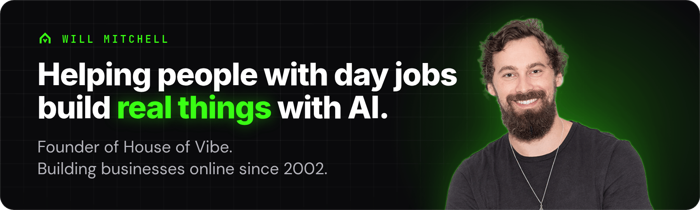
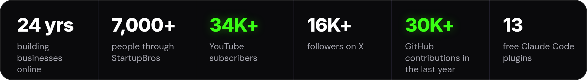
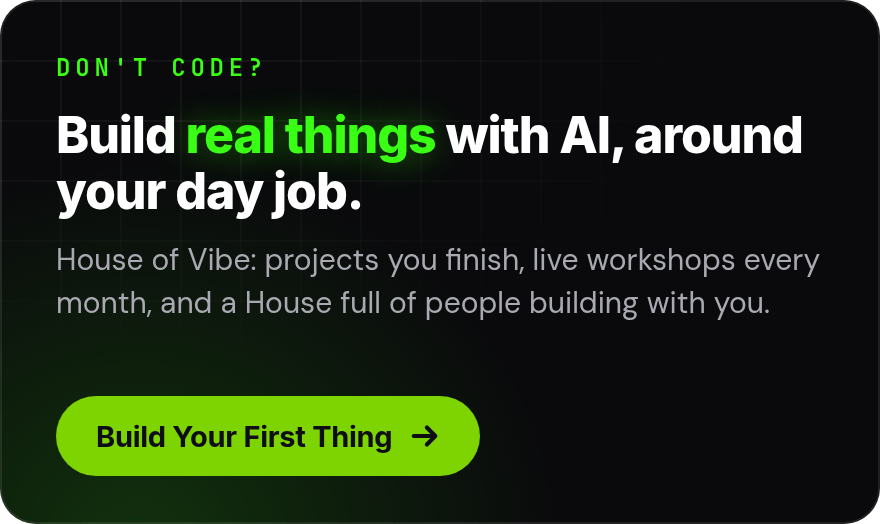
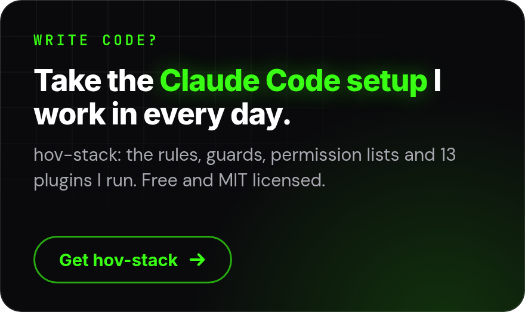
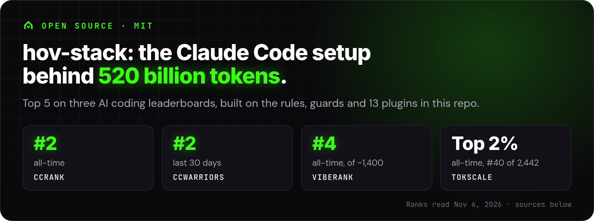
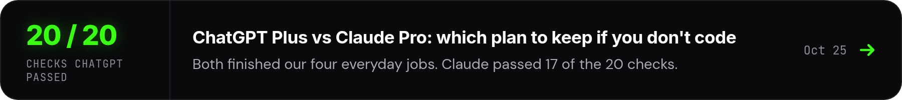
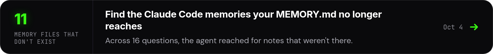
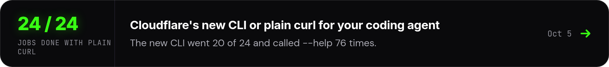
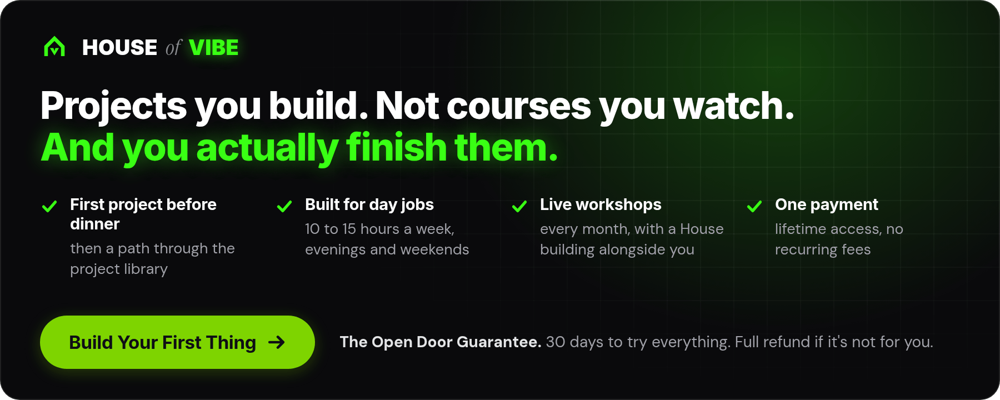

<p align="center"><a href="https://houseofvibe.ai/?utm_source=github&utm_medium=profile&utm_campaign=readme-banner"><picture><source media="(max-width: 600px)" srcset="https://raw.githubusercontent.com/StartupBros/startupbros/profile-v4/assets/v4/banner_m.png"></picture></a></p>

<p align="center">
  <a href="https://houseofvibe.ai/?utm_source=github&utm_medium=profile&utm_campaign=readme-links"></a>&nbsp;
  <a href="https://houseofvibe.ai/blog?utm_source=github&utm_medium=profile&utm_campaign=readme-links"></a>&nbsp;
  <a href="https://youtube.com/startupbros"></a>&nbsp;
  <a href="https://x.com/startupbros"></a>&nbsp;
  <a href="https://www.linkedin.com/in/willmitchell/"></a>
</p>

<p align="center"><a href="https://houseofvibe.ai/?utm_source=github&utm_medium=profile&utm_campaign=readme-proof"><picture><source media="(max-width: 600px)" srcset="https://raw.githubusercontent.com/StartupBros/startupbros/profile-v4/assets/v4/proof_m.png"></picture></a></p>

<p align="center"><a href="https://houseofvibe.ai/?utm_source=github&utm_medium=profile&utm_campaign=readme-fork"><picture><source media="(max-width: 600px)" srcset="https://raw.githubusercontent.com/StartupBros/startupbros/profile-v4/assets/v4/fork_hov_m.png"></picture></a> <a href="https://github.com/StartupBros-com/hov-stack"><picture><source media="(max-width: 600px)" srcset="https://raw.githubusercontent.com/StartupBros/startupbros/profile-v4/assets/v4/fork_dev_m.png"></picture></a></p>

<br>

<p align="center"><a href="https://github.com/StartupBros-com/hov-stack"><picture><source media="(max-width: 600px)" srcset="https://raw.githubusercontent.com/StartupBros/startupbros/profile-v4/assets/v4/stack_m.png"></picture></a></p>

Add the marketplace once, then install any plugin by name:

```
/plugin marketplace add StartupBros-com/hov-stack
/plugin install memory-dream@hov
```

<p align="center"><a href="https://github.com/StartupBros-com/hov-stack/tree/main/plugins"><picture><source media="(max-width: 600px)" srcset="https://raw.githubusercontent.com/StartupBros/startupbros/profile-v4/assets/v4/plugins_m.png"></picture></a></p>

<p align="center"><sub><b>All 13 plugins:</b> <a href="https://github.com/StartupBros-com/hov-stack/tree/main/plugins/memory-dream">memory-dream</a> · <a href="https://github.com/StartupBros-com/hov-stack/tree/main/plugins/token-eater">token-eater</a> · <a href="https://github.com/StartupBros-com/hov-stack/tree/main/plugins/papercut">papercut</a> · <a href="https://github.com/StartupBros-com/hov-stack/tree/main/plugins/skill-tuner">skill-tuner</a> · <a href="https://github.com/StartupBros-com/hov-stack/tree/main/plugins/wsl-cdp">wsl-cdp</a> · <a href="https://github.com/StartupBros-com/hov-stack/tree/main/plugins/design-rails">design-rails</a> · <a href="https://github.com/StartupBros-com/hov-stack/tree/main/plugins/harness-vet">harness-vet</a> · <a href="https://github.com/StartupBros-com/hov-stack/tree/main/plugins/rent-check">rent-check</a> · <a href="https://github.com/StartupBros-com/hov-stack/tree/main/plugins/harness-optimizer">harness-optimizer</a> · <a href="https://github.com/StartupBros-com/hov-stack/tree/main/plugins/product-video">product-video</a> · <a href="https://github.com/StartupBros-com/hov-stack/tree/main/plugins/sign-it">sign-it</a> · <a href="https://github.com/StartupBros-com/hov-stack/tree/main/plugins/pro-gate">pro-gate</a> · <a href="https://github.com/StartupBros-com/hov-stack/tree/main/plugins/hov-stack">hov-stack</a></sub></p>

<p align="center">More open source, pinned below: an <a href="https://github.com/StartupBros-com/renpho-mcp-server">MCP server for Renpho smart scales</a> (8 forks), a <a href="https://github.com/StartupBros-com/synthetic-panel">zero-key synthetic customer panel</a> for testing copy, and <a href="https://github.com/StartupBros-com/terminal-notifications">terminal notifications</a> for Mac, WSL2 and Linux.</p>

<br>

<h3 align="center">From House Notes</h3>

<p align="center">Tested how-tos from the House of Vibe blog, measured before I publish them. <a href="https://houseofvibe.ai/blog?utm_source=github&utm_medium=profile&utm_campaign=readme-notes">Read them all</a>.</p>

<p align="center"><a href="https://houseofvibe.ai/blog/chatgpt-plus-vs-claude-pro?utm_source=github&utm_medium=profile&utm_campaign=readme-notes"><picture><source media="(max-width: 600px)" srcset="https://raw.githubusercontent.com/StartupBros/startupbros/profile-v4/assets/v4/note_chatgpt_m.png"></picture></a></p>

<p align="center"><a href="https://houseofvibe.ai/blog/claude-code-auto-memory?utm_source=github&utm_medium=profile&utm_campaign=readme-notes"><picture><source media="(max-width: 600px)" srcset="https://raw.githubusercontent.com/StartupBros/startupbros/profile-v4/assets/v4/note_memory_m.png"></picture></a></p>

<p align="center"><a href="https://houseofvibe.ai/blog/cloudflare-cli-or-curl-for-coding-agents?utm_source=github&utm_medium=profile&utm_campaign=readme-notes"><picture><source media="(max-width: 600px)" srcset="https://raw.githubusercontent.com/StartupBros/startupbros/profile-v4/assets/v4/note_cloudflare_m.png"></picture></a></p>

<br>

<p align="center"><a href="https://houseofvibe.ai/?utm_source=github&utm_medium=profile&utm_campaign=readme-cta"><picture><source media="(max-width: 600px)" srcset="https://raw.githubusercontent.com/StartupBros/startupbros/profile-v4/assets/v4/pitch_m.png"></picture></a></p>

<p align="center">Know someone with a day job who keeps asking you about AI? Send them to <a href="https://houseofvibe.ai/?utm_source=github&utm_medium=profile&utm_campaign=readme-share">houseofvibe.ai</a>.</p>

<details>
<summary><sub>Where the numbers come from</sub></summary>

<br>

[](https://www.viberank.app/profile/StartupBros)

- Leaderboards, read Nov 6, 2026. Each board counts only what was submitted to it, so totals differ.
  - [viberank](https://www.viberank.app/profile/StartupBros): #4 all-time of about 1,400, with 520.0B Claude Code tokens logged, 93% of them cache reads. The badge above is live.
  - [ccrank](https://ccrank.dev/leaderboard): #2 all-time, 295.1B tokens across Claude Code, Codex and other tools.
  - [CCWarriors](https://ccwarriors.xyz/StartupBros): #2 of 82 on the 30-day board.
  - [tokscale](https://tokscale.ai/u/startupbros): #40 of 2,442 all-time by tokens (479.8B), the top 2%.
- 24 years and 7,000+ people: "I've been building businesses online since 2002. Over 7,000 people have come through my StartupBros programs," from [houseofvibe.ai](https://houseofvibe.ai/?utm_source=github&utm_medium=profile&utm_campaign=readme-sources).
- Audience: 34.8K YouTube subscribers (Nov 6, 2026) and 16,293 followers on X (Nov 5, 2026). 30,108 GitHub contributions in the last year (Nov 6, 2026).
- hov-stack: 13 plugins in its marketplace, MIT licensed. Its [README](https://github.com/StartupBros-com/hov-stack) reports 4,302 pull requests merged across 17 repos in the 60 days to Oct 19, 2026.
- House Notes results are quoted from each post.

</details>

---

<sub>Want me building inside your team instead? I take on fractional AI co-founder work: [willmitchell.com](https://willmitchell.com/?utm_source=github&utm_medium=profile&utm_campaign=readme-footer)</sub>
