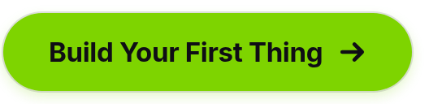

<a href="https://houseofvibe.ai/?utm_source=github&utm_medium=profile&utm_campaign=readme-banner"></a>

<p align="center">
  <a href="https://houseofvibe.ai/?utm_source=github&utm_medium=profile&utm_campaign=readme-links"><b>houseofvibe.ai</b></a>&nbsp;&nbsp;·&nbsp;&nbsp;<a href="https://houseofvibe.ai/blog?utm_source=github&utm_medium=profile&utm_campaign=readme-links">House Notes</a>&nbsp;&nbsp;·&nbsp;&nbsp;<a href="https://github.com/StartupBros-com/hov-stack">hov-stack</a>
  <br>
  <sub><a href="https://x.com/startupbros">X (16K)</a>&nbsp;&nbsp;·&nbsp;&nbsp;<a href="https://youtube.com/startupbros">YouTube</a>&nbsp;&nbsp;·&nbsp;&nbsp;<a href="https://www.linkedin.com/in/willmitchell/">LinkedIn</a></sub>
</p>

<table align="center">
  <tr>
    <td align="center" valign="top"><h3>7,000+</h3><sub>people through<br>StartupBros</sub></td>
    <td align="center" valign="top"><h3>#4</h3><sub>all-time on<br>viberank</sub></td>
    <td align="center" valign="top"><h3>13</h3><sub>free Claude<br>Code plugins</sub></td>
  </tr>
</table>

<p align="center">
  <b>Don't code?</b> House of Vibe is where people with day jobs build real things with AI.
  <br><br>
  <a href="https://houseofvibe.ai/?utm_source=github&utm_medium=profile&utm_campaign=readme-top"></a>
  <br><br>
  <b>Write code?</b> The Claude Code setup I work in is free, just below.
</p>

### The setup I build with, free

[**hov-stack**](https://github.com/StartupBros-com/hov-stack) is everything I run Claude Code with: the rules, the guards, the permission lists and the skills, plus a 13-plugin marketplace. The permission lists alone hold 292 allow, 75 ask and 70 deny entries, grown from real refusals.

Add the marketplace once, then install any plugin by name:

```
/plugin marketplace add StartupBros-com/hov-stack
/plugin install memory-dream@hov
```

<table>
  <tr>
    <td width="50%" valign="top">
      <a href="https://github.com/StartupBros-com/hov-stack/tree/main/plugins/memory-dream"><b>memory-dream</b></a><br>
      Finds stale and conflicting notes in Claude Code's auto-memory, shows you a diff for each fix, and applies only what you approve.
    </td>
    <td width="50%" valign="top">
      <a href="https://github.com/StartupBros-com/hov-stack/tree/main/plugins/token-eater"><b>token-eater</b></a><br>
      Puts AI credits that are about to expire to work: it tidies up your code in an isolated copy, checks nothing broke, and opens a draft pull request. It never merges.
    </td>
  </tr>
  <tr>
    <td width="50%" valign="top">
      <a href="https://github.com/StartupBros-com/hov-stack/tree/main/plugins/papercut"><b>papercut</b></a><br>
      Records the small failures your agents route around silently and turns them into ranked, tracked fixes.
    </td>
    <td width="50%" valign="top">
      <a href="https://github.com/StartupBros-com/hov-stack/tree/main/plugins/skill-tuner"><b>skill-tuner</b></a><br>
      Tells you whether an edit to a SKILL.md, AGENTS.md or CLAUDE.md actually worked, with an interval instead of a single number.
    </td>
  </tr>
</table>

Each plugin is plain files and hooks, so read it before you install. [Browse all 13 plugins](https://github.com/StartupBros-com/hov-stack/tree/main/plugins).

### From House Notes

Tested how-tos from the House of Vibe blog, measured before I publish them. [Read them all](https://houseofvibe.ai/blog?utm_source=github&utm_medium=profile&utm_campaign=readme-notes).

- [**ChatGPT Plus vs Claude Pro: which plan to keep if you don't code**](https://houseofvibe.ai/blog/chatgpt-plus-vs-claude-pro?utm_source=github&utm_medium=profile&utm_campaign=readme-notes)<br><sub>Both finished our four everyday jobs. ChatGPT passed all 20 checks first time, Claude 17.</sub>
- [**Find the Claude Code memories your MEMORY.md no longer reaches**](https://houseofvibe.ai/blog/claude-code-auto-memory?utm_source=github&utm_medium=profile&utm_campaign=readme-notes)<br><sub>Across 16 questions about our project's past, the agent reached for 11 memory files that don't exist.</sub>
- [**Cloudflare's new CLI or plain curl for your coding agent**](https://houseofvibe.ai/blog/cloudflare-cli-or-curl-for-coding-agents?utm_source=github&utm_medium=profile&utm_campaign=readme-notes)<br><sub>Across 48 runs of the same 12 jobs, curl and the API went 24 of 24. The CLI went 20 of 24 and called --help 76 times.</sub>

### House of Vibe

For people who don't code for a living and want to build with AI anyway. Projects you build, not courses you watch. I've built and sold companies, and I'm not teaching from a stage: I build inside the House every day, alongside the members.

- **Finish your first project before dinner**, then follow a recommended path through the project library.
- **Built for people with day jobs.** It runs on 10 to 15 hours a week, evenings and weekends.
- **Live workshops every month**, and a House full of people building alongside you.
- **One payment, lifetime access.** No recurring fees.

<a href="https://houseofvibe.ai/?utm_source=github&utm_medium=profile&utm_campaign=readme-cta"></a>

<sub>The Open Door Guarantee: 30 days to try everything. Full refund if it's not for you.</sub>

Know someone with a day job who keeps asking you about AI? Send them to [houseofvibe.ai](https://houseofvibe.ai/?utm_source=github&utm_medium=profile&utm_campaign=readme-share).

<details>
<summary><sub>Where the numbers come from</sub></summary>

<br>

[](https://www.viberank.app/profile/StartupBros)

- viberank: #4 all-time out of about 1,400, with 520.0B tokens logged, 93% of them cache reads. Read Nov 5, 2026. [Profile](https://www.viberank.app/profile/StartupBros).
- Other boards the same day: #2 of 82 on [CCWarriors](https://ccwarriors.xyz/StartupBros)' 30-day board, #2 all-time on [ccrank](https://ccrank.dev/leaderboard) (295.1B), #40 of 2,442 on [tokscale](https://tokscale.ai/u/startupbros) (479.8B). Each board counts only what was submitted to it, so totals differ.
- 7,000+ people: "Over 7,000 people have come through my StartupBros programs," as stated on [houseofvibe.ai](https://houseofvibe.ai/?utm_source=github&utm_medium=profile&utm_campaign=readme-sources).
- hov-stack: 13 plugins in its marketplace, MIT licensed. Its [README](https://github.com/StartupBros-com/hov-stack) reports 4,302 pull requests merged across 17 repos in the 60 days to Oct 19, 2026.
- X: 16,293 followers on Nov 5, 2026.

</details>

---

<sub>Want me building inside your team instead? I take on fractional AI co-founder work: [willmitchell.com](https://willmitchell.com/?utm_source=github&utm_medium=profile&utm_campaign=readme-footer)</sub>
